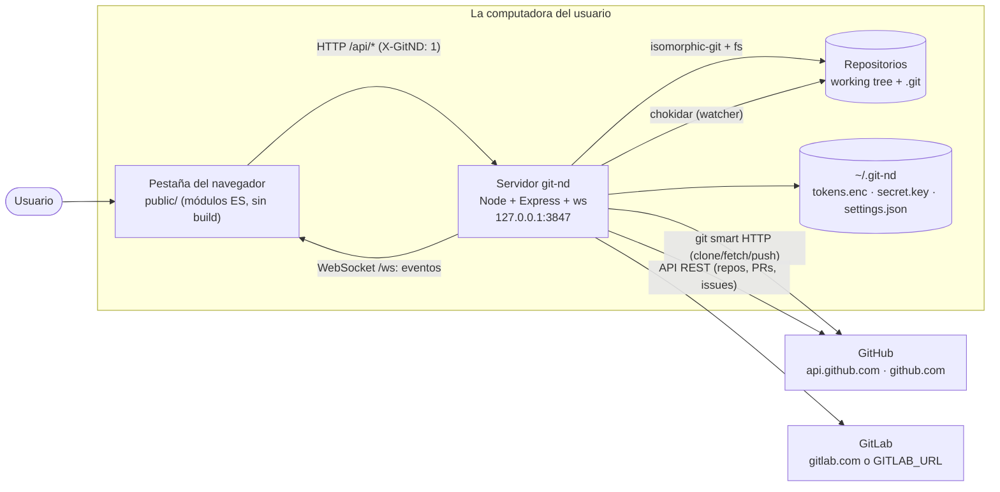
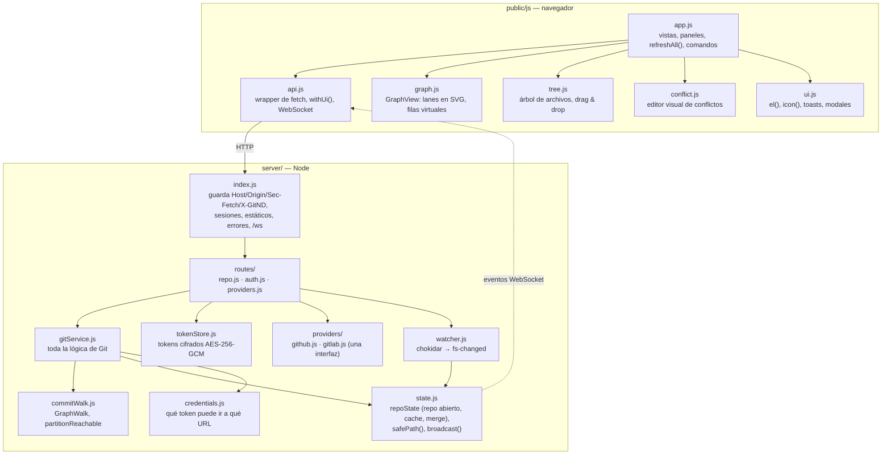

# Arquitectura

git-nd es un **cliente Git local, de un solo usuario, con interfaz web**. Un
proceso Node maneja repositorios reales en disco con
[isomorphic-git](https://isomorphic-git.org/) (no hace falta el binario
`git`), y una página en JavaScript sin framework lo controla desde el
navegador por HTTP y un WebSocket. No hay nada hosteado: el servidor escucha
solo en `127.0.0.1`.

Para ver *cómo pasan las cosas* paso a paso (abrir un repo, commit,
push/pull, conflictos de merge, el grafo paginado, conectar una cuenta), están
los diagramas de secuencia de [flows.md](flows.md). Para el *por qué* de una
decisión cara de revertir, los registros de decisiones en
[adr/](adr/README.md).

## Contexto

- **El navegador nunca habla con GitHub/GitLab** y nunca tiene un token.
  Toda operación de red pasa por el servidor, que elige el token (ver
  [Límites de confianza](#límites-de-confianza)).
- **Un solo repositorio abierto a la vez**, compartido por todas las
  pestañas: abrir un repo en una pestaña cambia el repo del servidor, y las
  demás se enteran (evento `repo-opened`) y recargan.

## Componentes

### Servidor (`server/`)

| Módulo | Responsabilidad |
| --- | --- |
| `index.js` | Servidor HTTP + WebSocket. Un único middleware aplica las reglas de seguridad de localhost (abajo); después vienen las sesiones (solo para el `state` de OAuth), los archivos estáticos y los tres routers. Los errores salen como `{ error, code }` con un status: los códigos de error de isomorphic-git se traducen a mensajes legibles y un stack trace nunca llega al navegador. |
| `routes/repo.js` | Los endpoints `/api/repo/*` y `/api/fs/browse`. Finos: validan, llaman a `gitService` y emiten un evento con `broadcast()` después de cada cambio. |
| `routes/auth.js` | Login y callback de OAuth (`/auth/:provider/*`, con un `state` atado a la sesión), pegar un PAT (`/api/auth/token`), estado y logout. |
| `routes/providers.js` | Llamadas REST a los providers (listar repos, PRs, issues) con el token guardado. |
| `gitService.js` | **Todo el comportamiento de Git**: status, stage (por archivo y por hunk), commit/amend, ramas, tags, merge/rebase/pull/push, revert/cherry-pick, diff, stash, árbol y archivos. Toda llamada a isomorphic-git pasa por un `Proxy` que inyecta la cache compartida del repo abierto. |
| `commitWalk.js` | Recorridos que siguen el grafo real en lugar de ventanas de profundidad fija: `GraphWalk` (un único recorrido por fecha desde todas las puntas, que solo crece y se puede paginar) y `partitionReachable` (ahead/behind, base del rebase). |
| `state.js` | `repoState`: el repo abierto, su cache de isomorphic-git (se descarta tras 10 minutos sin uso o al cambiar de repo), el recorrido paginado del grafo y el merge en curso. También `safePath()` y el `broadcast()` del WebSocket. |
| `credentials.js` | `authFor(tokens)`: el `onAuth` de isomorphic-git que entrega un token **solo** al host exacto de su provider y por https. `NO_REPO_PROXY` deja afuera un proxy configurado por el repo. |
| `tokenStore.js` | Tokens cifrados en reposo en `~/.git-nd/tokens.enc` (clave en `secret.key`, modo 0600, o `GITND_KEY`). |
| `watcher.js` | chokidar sobre el working tree y sobre `.git/HEAD`, `refs`, `index` y `packed-refs`; agrupa los cambios (debounce) en un solo evento `fs-changed`. |
| `providers/` | GitHub y GitLab detrás de una sola interfaz (`getUser`, `listRepos`, PRs, issues, `oauth`, ayuda del `token`). Un provider nuevo es una clase registrada en `providers/index.js`. |
| `settings.js` | Configuración de la app (`~/.git-nd/settings.json`), por ejemplo el autor por defecto. |

### Cliente (`public/`)

Sin framework y sin build: módulos ES servidos tal cual.

| Módulo | Responsabilidad |
| --- | --- |
| `app.js` | Las tres vistas (Explorer, Repository, Connections), todos los paneles y comandos, y `refreshAll()`: la única función que recarga juntos info, status, ramas, historial y la primera página del grafo. |
| `graph.js` | `GraphView`: arma las lanes de los commits cargados hasta el momento y dibuja solo las filas visibles de 28 px (SVG virtualizado). Las páginas se agregan al final; las filas nunca se mueven. |
| `tree.js` | Árbol de archivos con carga diferida, marcas de estado git, operable con teclado y drag & drop para agregar archivos. |
| `conflict.js` | Separa los marcadores de conflicto en bloques; Keep local / Take incoming / Both / Edit por bloque. |
| `ui.js` | Helper de DOM `el()` (todo lo clickeable queda operable con teclado), `icon()` (sprite SVG), toasts, modales, íconos por tipo de archivo y fechas relativas. |
| `api.js` | `api.get/post` (siempre manda `X-GitND: 1`), `withUi()` (spinner + toast de error) y el WebSocket con reconexión automática y `onEvent()`. |
| `icons/` | `sprite.svg` (Lucide + Simple Icons, licencias en `icons/LICENSE`) y `favicon.svg`. |
| `css/style.css` | Tokens de diseño por tema (`:root[data-theme]`), con contraste WCAG AA verificado por `test/contrast.test.js`. |

## Dónde vive el estado

La regla: **el disco es la fuente de verdad; la memoria es una cache.** Todo
lo que el servidor guarda en memoria se puede reconstruir desde el
repositorio, así que un reinicio, una segunda pestaña o un comando `git` en
una terminal nunca dejan a git-nd creyendo algo falso.

| Estado | Dónde vive | Notas |
| --- | --- | --- |
| Qué repo está abierto | memoria del servidor (`repoState.dir`) | Uno por servidor, compartido por todas las pestañas. El navegador guarda la lista de recientes en `localStorage`. |
| Commits, refs, index, working tree | el repositorio en disco | Se leen con isomorphic-git. |
| Merge en curso | `.git/MERGE_HEAD` + `.git/MERGE_MSG` (como lo hace git) | Se relee antes de cada operación relacionada con el merge (`loadMergeState`), así que un merge empezado o terminado con la CLI de git se detecta. "Resuelto" se deriva del index; nunca se guarda. |
| Cache de isomorphic-git (packfiles parseados) | memoria del servidor | Una por repo abierto; son datos inmutables, así que no queda desactualizada. Todas las llamadas, lecturas y escrituras, usan la misma cache. Ver [ADR-0001](adr/0001-carga-del-grafo-en-repos-grandes.md). |
| Recorrido paginado del grafo | memoria del servidor (`repoState.graphWalk`) | Identificado por un hash de HEAD + todas las refs (`walkId`). Un cambio de refs lo invalida. |
| Tokens | `~/.git-nd/tokens.enc` (cifrado) | Nunca se mandan al navegador. |
| Autor por defecto | `~/.git-nd/settings.json` | El autor de cada repo vive en su `.git/config`. |
| `state` de OAuth | sesión del servidor (cookie `httpOnly`, `SameSite=Lax`) | Solo se usa durante el ida y vuelta de OAuth. |
| Preferencias de la UI (tema, modo de pull, sidebar Files colapsado, recientes) | `localStorage` del navegador | Por navegador; con try/catch donde importa. |

## Límites de confianza

La API no tiene login: está protegida porque **solo se puede alcanzar desde
esta máquina y solo desde la página de git-nd**. Eso convierte la guarda de
`index.js` en el límite de seguridad, que verifica en este orden:

1. **`Host`** es `localhost:<puerto>`, `127.0.0.1:<puerto>` o
   `[::1]:<puerto>` → frena el DNS rebinding (un nombre público que resuelve
   a 127.0.0.1).
2. **`Origin`**, si viene, es uno de esos → frena los POST de otros sitios.
3. **`Sec-Fetch-Site`**, si viene, es `same-origin` o `none` → frena los GET
   de otros sitios vía ``/`<script>`, que no mandan `Origin`.
4. **`X-GitND: 1`** en toda ruta `/api` (comparada sin distinguir mayúsculas
   y decodificada, como rutea Express) → un header que otro origen no puede
   agregar sin un preflight de CORS que el servidor nunca concede.

El upgrade del WebSocket verifica `Host` y `Origin` en `verifyClient`, antes
de completar el handshake.

Adentro, los datos que vienen **de un repositorio no son confiables**:

- **Rutas**: toda ruta relativa al repo pasa por `repoState.safePath()`: no
  se puede escapar con `..`, ni a través de un directorio que sea symlink
  hacia afuera, ni pasar por un componente `.git/` (sin distinguir
  mayúsculas); y para leer o escribir contenido, tampoco por un symlink final
  que apunte afuera.
- **URLs de remotos**: un repo elige su propio `origin`/`pushurl`. `authFor()`
  entrega un token solo al host **exacto** del provider y por **https** (la
  única excepción por http es un GitLab self-hosted configurado como
  `GITLAB_URL=http://…`), para la URL que isomorphic-git está pidiendo de
  verdad. `corsProxy: null` impide que un proxy configurado en el repo vea el
  tráfico.
- **Merges**: nunca pisan trabajo sin commitear. `requireMergeableTree()` se
  niega antes de tocar el working tree.

## Reglas de consistencia

La UI se refresca desde varias fuentes (acciones del usuario, eventos del
WebSocket, un fetch cada 2 minutos) que se pueden superponer. Estas reglas
evitan que muestre datos viejos o actúe sobre ellos; cada una salió de un bug
registrado en `BACKLOG.md`:

- **Gana la petición más nueva.** `refreshAll()`, el árbol, el listado de
  carpetas de Explorer y la vista previa del destino del clone numeran sus
  peticiones; una respuesta que llega después de que empezó otra más nueva se
  descarta (B-18).
- **Nunca mostrar datos de otro repo.** `refreshAll()` usa `allSettled`: un
  panel que falla se muestra vacío en lugar de quedarse con el contenido del
  repo anterior (B-08), y un repo cambiado desde otra pestaña cierra todas las
  vistas ligadas al viejo (B-04).
- **No pisar lo que el usuario está escribiendo.** Un listado lento no
  reemplaza una ruta escrita mientras tanto (R2-7); un cambio externo no
  recarga un archivo con cambios sin guardar, lo marca (editor de archivos).
- **Releer antes de actuar.** El estado del merge se lee del disco antes de
  resolver, completar, abortar, hacer pull o commit (B-06).
- **El grafo solo crece.** Las páginas se agregan al final; un cambio de refs
  mientras se pagina devuelve `409` y el cliente recarga desde arriba
  (ADR-0001).

## Eventos

El servidor emite mensajes JSON `{ type, payload, ts }` por `/ws`, y todas las
pestañas los reciben.

| Evento | Se emite después de | El cliente |
| --- | --- | --- |
| `fs-changed` | que el watcher vio cambios (debounce de 350 ms) | espera 250 ms más, después `refreshAll()` y revisa el archivo abierto |
| `file-changed` | escribir un archivo, operar sobre hunks o resolver un conflicto | `refreshAll()` |
| `repo-opened` | abrir o clonar | `refreshAll()` (otra pestaña puede haber cambiado el repo) |
| `commit-completed`, `branch-changed`, `merge-updated`, `pull-finished`, `push-finished`, `stash-updated` | la operación correspondiente | informativos: la pestaña que actuó se refresca sola y el watcher cubre el resto |

## Tests

| Suite | Comando | Qué cubre |
| --- | --- | --- |
| Unitarios / servicio / HTTP | `pnpm test` (`node:test`, `test/`) | Comportamiento de Git contra repos reales armados con la CLI de `git` en carpetas temporales, la guarda de requests, credenciales, contraste de los tokens de diseño, el sprite de íconos. Corre en CI en cada push a `main`. |
| End-to-end | `pnpm e2e` (Playwright sobre Chrome, `e2e/`) | La UI tal como la usa una persona: cada worker levanta su propio servidor con un `HOME` temporal. A demanda (workflow manual). |

Los tests nunca tocan los repositorios, la configuración ni los tokens del
usuario. Cada
bug corregido tiene un test que fallaba antes del fix; la lista está en
`BACKLOG.md`.

## Decisiones

- **isomorphic-git sobre el `fs` real de Node**, no un FS virtual del
  navegador: abre los repositorios que ya existen en disco y no necesita el
  binario `git`.
- **JavaScript sin framework ni build**: la app es chica y local; los módulos
  ES se cargan tal cual.
- **Tokens del lado del servidor**, cifrados en reposo; el navegador nunca
  los ve.
- **Un repo abierto a la vez**, para todo el servidor: es una herramienta
  local de un solo usuario.
- Repositorios grandes: [ADR-0001](adr/0001-carga-del-grafo-en-repos-grandes.md)
  — cache compartida, un único recorrido paginado por fecha, recorridos de
  alcanzabilidad para ahead/behind.
