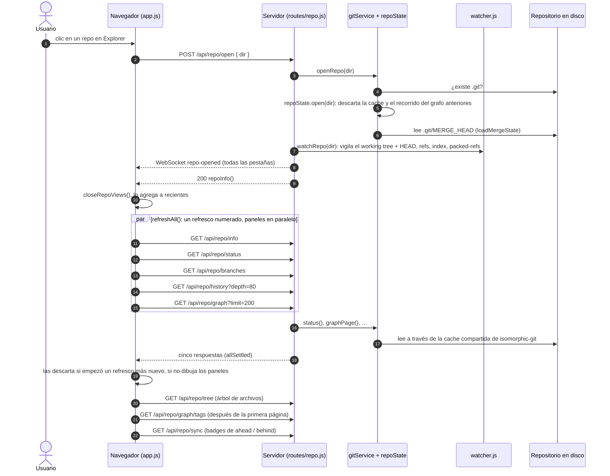
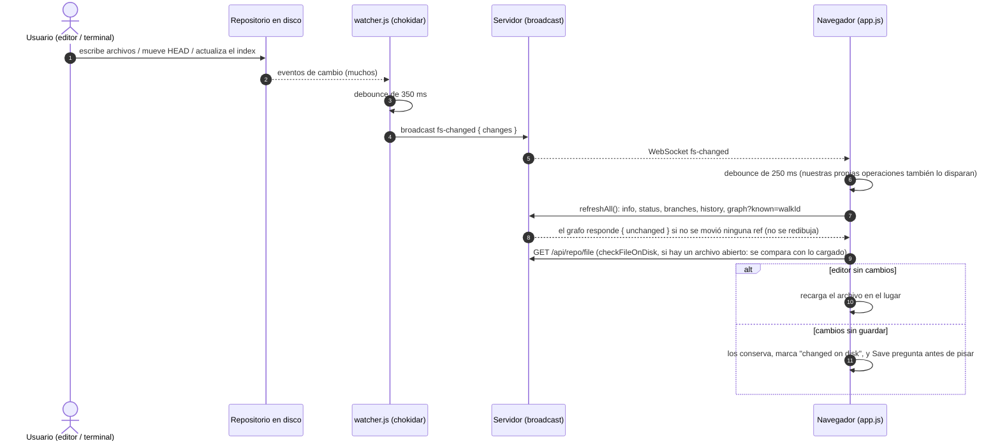
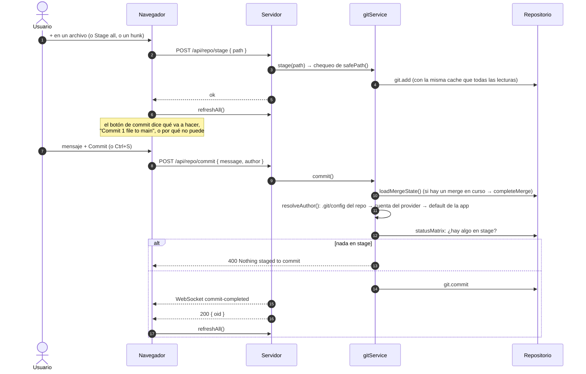
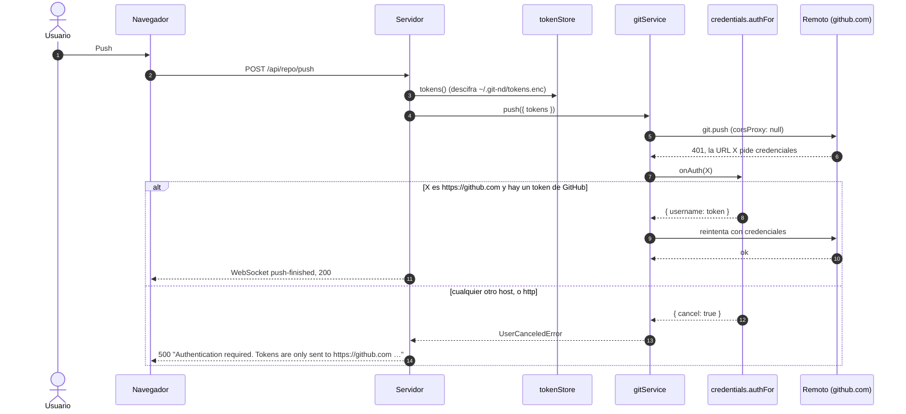
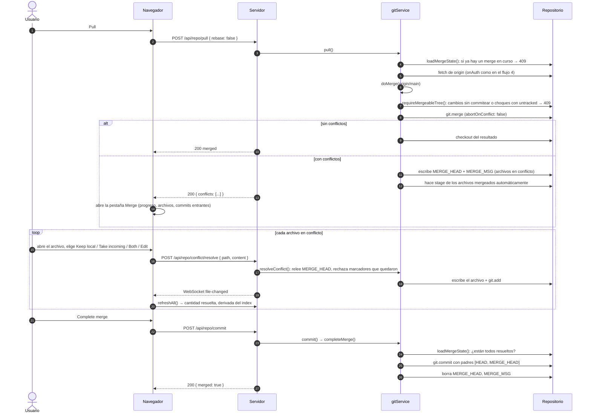
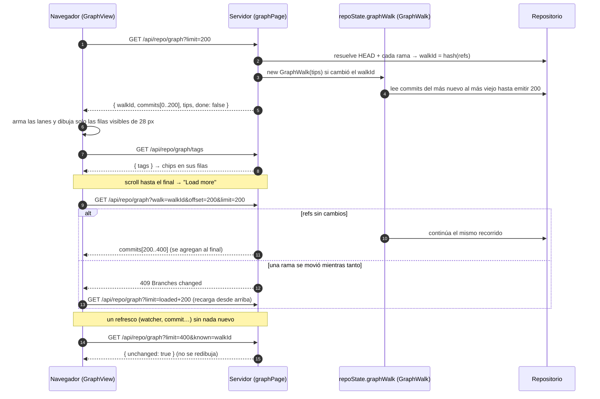
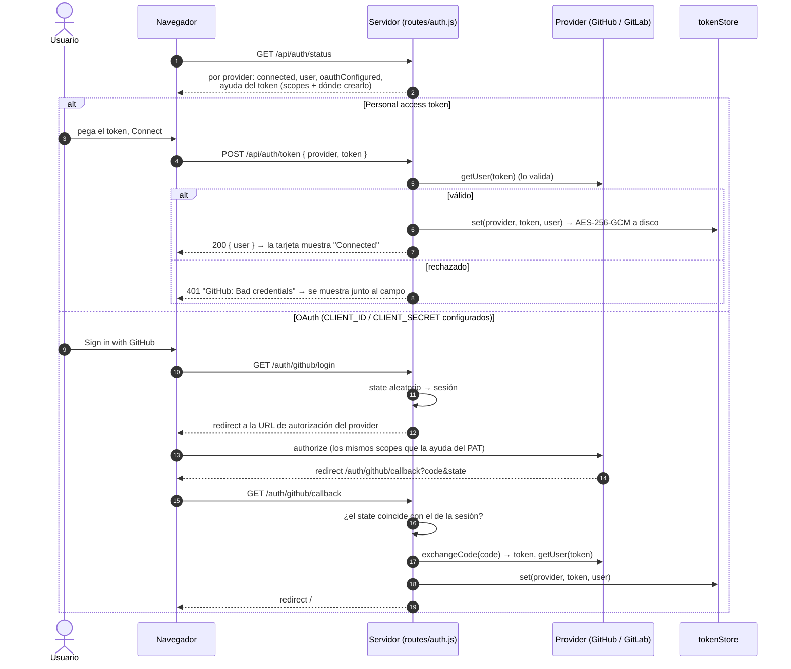
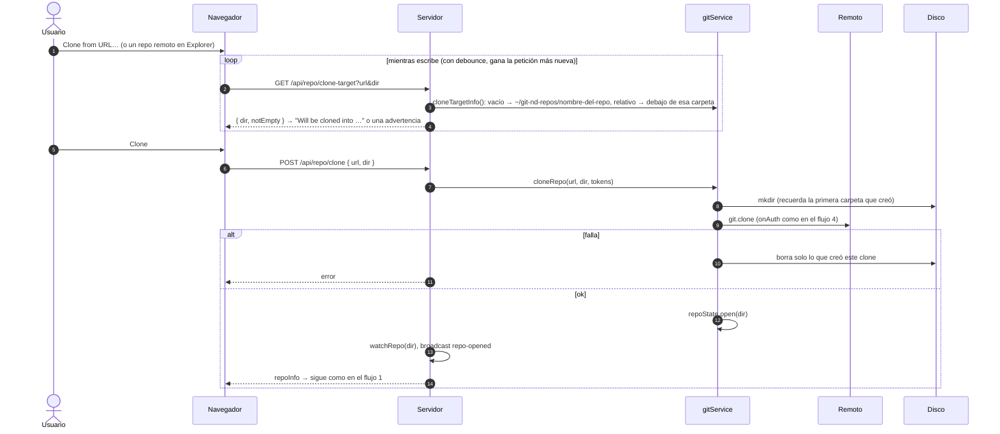

# Cómo funciona: flujos principales

Diagramas de secuencia de lo que pasa entre el navegador, el servidor, el
repositorio en disco y los providers. Los nombres que aparecen en los
diagramas son las funciones y endpoints reales, así que cada paso se puede
buscar en el código. Las piezas en sí están descritas en
[architecture.md](architecture.md).

1. [Abrir un repositorio](#1-abrir-un-repositorio)
2. [Un cambio externo (editor, terminal)](#2-un-cambio-externo-editor-terminal)
3. [Stage y commit](#3-stage-y-commit)
4. [Push, fetch y qué token va a dónde](#4-push-fetch-y-qué-token-va-a-dónde)
5. [Pull con conflictos → resolver → completar](#5-pull-con-conflictos--resolver--completar)
6. [El grafo de commits paginado](#6-el-grafo-de-commits-paginado)
7. [Conectar una cuenta](#7-conectar-una-cuenta)
8. [Clonar](#8-clonar)

---

## 1. Abrir un repositorio

Desde Explorer (un reciente, una carpeta o "Open this repository"). Abrir un
repo afecta a todo el servidor: se avisa a todas las pestañas abiertas y
todas recargan.

- Un panel que falla se muestra vacío, nunca con el contenido del repo
  anterior.
- Otra pestaña recibe `repo-opened`, ejecuta `refreshAll()`, ve un
  `info.dir` distinto y cierra todo lo que estaba ligado al repo viejo.

## 2. Un cambio externo (editor, terminal)

Se guarda un archivo en el editor o se corre `git checkout` en una terminal.
git-nd se entera sin hacer polling.

## 3. Stage y commit

## 4. Push, fetch y qué token va a dónde

La URL del remoto la define el repositorio, así que no es confiable: el token
se elige para la URL que isomorphic-git **realmente** está pidiendo, por host
exacto y solo por https.

El fetch funciona igual (`POST /api/repo/sync/fetch`, también cada 2
minutos). Después cuenta **ahead / behind** con `partitionReachable`, que
recorre el grafo real en lugar de comparar logs de profundidad fija.

## 5. Pull con conflictos → resolver → completar

El merge en curso se guarda como lo guarda git (`.git/MERGE_HEAD`,
`.git/MERGE_MSG`) y se vuelve a leer antes de cada paso, así sobrevive a un
reinicio y coincide con lo que ve la CLI de git.

`Abort merge…` relee `MERGE_HEAD` primero (un merge que ya se terminó desde
una terminal no se puede "abortar" pisando trabajo más nuevo), después hace
checkout de la rama y borra los archivos del merge.

## 6. El grafo de commits paginado

Un único recorrido por fecha desde todas las puntas de rama, que se guarda en
el servidor y se extiende página por página. Las páginas solo se agregan al
final, así que las filas que ya están en pantalla nunca se mueven. Por qué
funciona así: [ADR-0001](adr/0001-carga-del-grafo-en-repos-grandes.md).

## 7. Conectar una cuenta

Dos caminos con el mismo resultado: un token cifrado en el servidor y la
identidad del usuario, que se muestra en Connections.

## 8. Clonar

